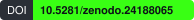
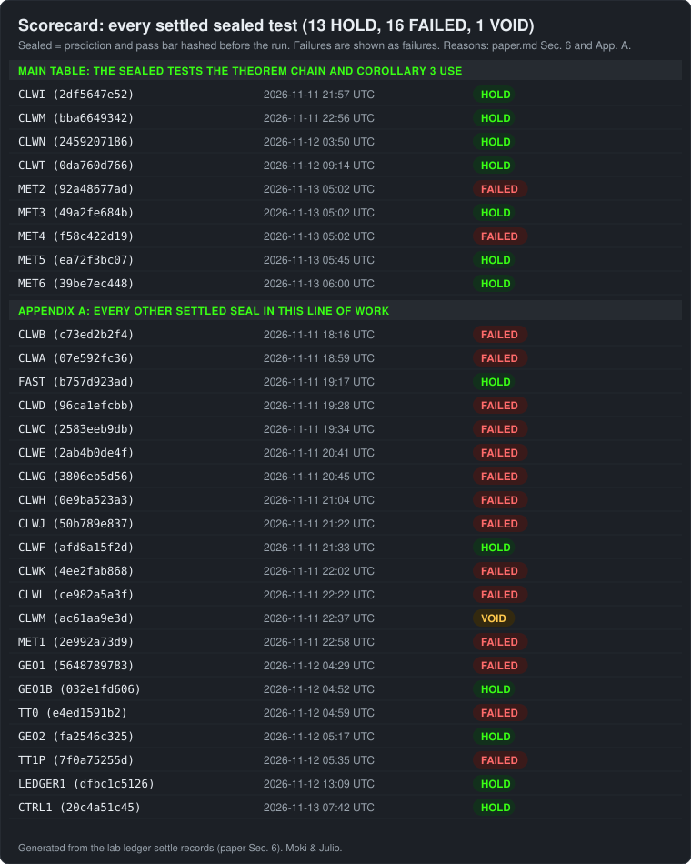

# A certified approximation of the Chen-LeBrun-Weber Einstein metric

**The Chen-LeBrun-Weber metric, a solution of Einstein's equations known since 2008 only as an existence theorem, now has an explicit computed version and a proof that the true metric lies within about 5.5 parts in 100 million of it (conditional on cited results).**

[](https://doi.org/10.5281/zenodo.24188065)  [](https://github.com/Hashirama1337s)

Moki & Julio · 2026 · version 1.0

**Read** [paper.md](paper.md) · **Re-run** [code/RUN.md](code/RUN.md) (the final certificate and the assembly, seconds) ·
**Check** [data/SHA256SUMS-PROD-met6.txt](data/SHA256SUMS-PROD-met6.txt) and [MANIFEST.sha256](MANIFEST.sha256)

## In plain words

The Chen-LeBrun-Weber (CLW) metric is a special shape of a four-dimensional space: an Einstein metric, the kind of
geometry that solves Einstein's equations in empty space with a cosmological constant (a curved space with no time
direction). It lives on the manifold
$`\mathbb{CP}^2\#2\overline{\mathbb{CP}^2}`$. Its existence was proved in 2008, but nobody can write it down by a formula.

We computed a very accurate approximate version of it on a computer. Then we used interval-style arithmetic (every
number carries a guaranteed error bar) to prove that the true metric sits within a tiny, explicit distance of our
computed one. At every point, the two metrics differ by a factor of at most $`1 \pm 5.504\times10^{-8}`$ (about 5.5 parts
in 100 million). This proof assumes several published results that we cite (listed in Section 7 of the paper). One of them, the one
that names the metric as CLW, is a preprint, and one boundary-condition step is not yet fully sourced.

The existence of the metric is not new. What is new is the certified location: an explicit, checkable statement of
where the metric is. A second result follows from it: the CLW metric has exactly one scalar vibration mode below the
threshold $`2\Lambda`$, where $`\Lambda`$ is the curvature constant of the space.

 **The idea in one picture.** A theorem can tell you that a mountain has a summit without telling you where it
is. For this metric, that was the situation since 2008. We planted a flag and proved, relying on results we cite,
that the true summit lies within a tiny, stated distance of the flag. **Where the picture breaks.** The "summit" is
not a point but a whole curved four-dimensional shape, the distance is measured between two shapes at every point,
and the proof leans on cited results, one of them a preprint.

We also list every pre-registered test we ran on the way, including the 16 that failed.

## At a glance

- **Certified location.** An explicit polynomial symplectic potential (the Guillemin potential plus a degree-84 correction)
  for the extremal Kähler metric conformal to the Chen-LeBrun-Weber (CLW) Einstein metric on $`\mathbb{CP}^2\#2\overline{\mathbb{CP}^2}`$.
  The true extremal metric lies within $`\|\psi\|_{H^6}\le 7.568\times10^{-10}`$ of it, for every class in the $`a^*`$ ball.
- **Pointwise.** At the critical class, the CLW metric $`h`$ and the rescaled approximant satisfy
  $`(1-d_h)\tilde h\le h\le(1+d_h)\tilde h`$ with $`d_h\le5.504\times10^{-8}`$.
- **Scalar gap (corollary).** Exactly one scalar Laplace eigenvalue in $`(0,2\Lambda)`$:
  $`\lambda_1/\Lambda\le1.948367728`$ and $`\lambda_2/\Lambda\ge2.089704146`$.
- **How.** A Newton-Kantorovich (contraction-mapping) argument for the fourth-order Abreu equation, closed with interval
  (Arb) arithmetic over the whole closed pentagon: $`x=0.177254749606<1`$, 18/18 gates.
- **Conditions.** Computer-assisted, and conditional on the cited inputs listed in Section 7 of the paper. The step that
  names the metric as CLW uses a preprint (Li-Sun), and one boundary-condition step is not yet fully sourced.
- **Not new.** The existence of the CLW metric (Chen, LeBrun and Weber, 2008). New: the certified location, the method, and the
  eigenvalue count.
- **Honesty.** Every test was sealed before its run: 30 settled seals, 13 HOLD, 16 FAILED, 1 VOID.



## What we do not claim

- The existence of the CLW metric is not new (Chen, LeBrun and Weber, 2008). New: the certified location, the method, and the eigenvalue count.
- The proof is computer-assisted and conditional on the cited inputs listed in Section 7 of the paper.
- The step that names the metric as CLW uses a preprint (Li-Sun), and one boundary-condition step is not yet fully sourced.
- Of 30 settled sealed tests, 16 FAILED and 1 was VOID; all are in the scorecard.

## Reproduce and reuse

Commands, expected outputs and run times: [code/RUN.md](code/RUN.md) (the final certificate and the assembly take seconds). Hashes: [data/SHA256SUMS-PROD-met6.txt](data/SHA256SUMS-PROD-met6.txt) and [MANIFEST.sha256](MANIFEST.sha256).

### What is in this repository

- `paper.md`: the paper. `CLAIMS.md`: the source file and line of every number in it. `PRIOR-ART-CERT.md`: the prior-art search.
- `data/`: the certificate (`cert_refined_a1.json`), the assembly result (`result_refined_a1.json`) and its log, the null
  certificate that must fail, the 160 frozen production files (`prodA3/`, `prodB1/`), hash lists, and the BAR-CTRL1
  containment-control counts (`ctrl1/`).
- `code/`: the production, certificate, assembly and control scripts, in the lab's folder layout (`seatE/`, `seatR/`,
  `seatG45/`, `seatB2/`, `seatX/`, `controls/`), with `RUN.md` and `PATCHES.md`.
- `chips/`, `brand/`, `scorecard.svg`: the verdict chips, badges and scorecard.

## How to cite

```
Moki & Julio (2026). A certified approximation of the Chen-LeBrun-Weber Einstein metric. Version 1.0. Zenodo. https://doi.org/10.5281/zenodo.24188065
```

The DOI always resolves to the newest archived version. Version 1.0 is 10.5281/zenodo.24188066. Machine-readable: [CITATION.cff](CITATION.cff).
Text and data: CC BY 4.0 (`LICENSE`). Code in `code/`: MIT (`LICENSE-CODE`).

## Related projects

- [large-d-gregory-laflamme](https://github.com/Hashirama1337s/large-d-gregory-laflamme): the Gregory-Laflamme threshold of a black string as an exact large-dimension series
- [airy-edge-hydrodynamics](https://github.com/Hashirama1337s/airy-edge-hydrodynamics): where the fluid series of a holographic plasma stops working, followed to large dimension
- All projects: [the Moki & Julio lab map](https://github.com/Hashirama1337s)

---

*Prepared with AI assistance; what was checked, and by what, is stated above.*
